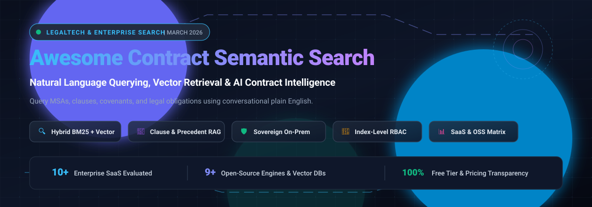

# 📜 Awesome Contract Natural Language & Semantic Search 🔍

> A curated directory of SaaS platforms, enterprise AI search engines, and open-source frameworks for **Contract Natural Language Search**, **Semantic Clause Retrieval**, and **Contract Intelligence**.

  
  
  
  
  
  
  

---

Legal and deal teams spend thousands of hours manually hunting through agreements, master services agreements (MSAs), statements of work (SOWs), and amendments. Modern contract semantic search allows teams to query repositories using plain English questions (e.g., *"Find all non-standard indemnification caps exceeding 2x fees"* or *"Show all unilateral termination-for-convenience clauses with under 30 days notice"*) rather than fragile Boolean keyword strings. 💡

---

## 📑 Table of Contents
- [🌐 Sector Overview & Market Dynamics](#-sector-overview--market-dynamics)
- [☁️ SaaS & Hosted Platforms](#️-saas--hosted-platforms)
- [🔓 Open-Source GitHub Projects](#-open-source-github-projects)
- [🏗️ Key Architectural Considerations](#️-key-architectural-considerations)
- [🤝 How to Contribute](#-how-to-contribute)
- [💖 Support](#-support)
- [⭐ Star History](#-star-history)
- [⚠️ Disclaimer](#️-disclaimer)

---

## 🌐 Sector Overview & Market Dynamics

The enterprise search and contract intelligence sector is valued at approximately **$5.6B – $7.5B for enterprise search** (projected at ~9% CAGR) and **$2.5B – $3.7B for contract lifecycle management & intelligence** (with AI-driven segments growing at 15–23% CAGR). The market is **moderately fragmented**: general enterprise semantic search is consolidating around multi-billion-dollar hyperscalers and frontier AI search providers (Elastic, Glean, Amazon, Perplexity), while domain-specific legal and contract intelligence remains split between vertical CLM incumbents (Icertis, Ironclad) and specialized agentic retrieval startups (Hebbia, OpenContracts). 📈

---

## ☁️ SaaS & Hosted Platforms

*Below is a curated comparison of major commercial SaaS search and contract intelligence platforms, ranked in descending order by company scale (market capitalization / enterprise valuation / ARR).* 🏢

| Product | Company Scale (Valuation / Revenue) | Description | Starting Pricing (Specific Tier) | Free Tier / Free Trial Limits |
|:---|:---|:---|:---|:---|
| **[Amazon Kendra](https://aws.amazon.com/kendra/)** | **~$2.2 Trillion** market cap (Amazon parent) | Managed semantic search service powered by deep learning and natural language processing. *(Note: Ceasing new customer onboarding on July 30, 2026; existing workloads continue).* | **$0.14/hour** (~$100.80/month for Developer Edition base capacity unit) | **30-day free trial** with up to 750 hours of Developer Edition base capacity unit; no permanent free tier. |
| **[Perplexity Enterprise](https://www.perplexity.ai/)** | **$20.0 Billion** valuation (~$450M–$750M ARR) | AI conversational answer engine with internal corporate search, file grounding, citation verification, and enterprise SOC 2 compliance. | **$40/user/month** (Enterprise Pro tier, or $400/user/year) | **Free forever plan** with unlimited basic search, 3 Pro searches/day, and 1 Deep Research query/month; custom enterprise pilot via sales. |
| **[Elasticsearch (Elastic Cloud)](https://www.elastic.co/)** | **$9.2 Billion** market cap (~$1.8B annual revenue) | Distributed search and analytics engine supporting dense vector search (HNSW), ELSER semantic reranking, and hybrid BM25 + vector search over document corpuses. | **$95/month** (Elastic Cloud Standard hosted tier) | **14-day free trial** on Elastic Cloud direct signup (restricted to 1 deployment, up to 8 GB total RAM); 30-day trial for self-managed licenses. |
| **[Glean](https://www.glean.com/)** | **$7.2 Billion** valuation (~$300M ARR) | AI workplace search and knowledge assistant connecting across Google Workspace, Jira, Salesforce, Slack, and cloud contract repositories. | **$50/user/month** (Enterprise tier, requires 100-user minimum ~$60,000/year base commitment) | **No permanent free tier**; no self-serve free trial (requires sales-assisted enterprise POC / demo). |
| **[Icertis Enterprise Search](https://www.icertis.com/)** | **$2.8B – $5.0 Billion** valuation (~$350M ARR) | Enterprise Contract Lifecycle Management (CLM) with Icertis Vera AI, natural language semantic search, clause discovery, and role-based access filtering. | **$88,000/year** (typical entry enterprise subscription contract value) | **No permanent free tier**; scheduled sandbox/demo provided during enterprise procurement. |
| **[Algolia](https://www.algolia.com/)** | **$2.25 Billion** valuation (~$75M+ revenue) | Hosted search-as-a-service API offering NeuralSearch (hybrid keyword + vector embeddings retrieval) and instant auto-complete query suggestions. | **$0/month** on Build plan; paid Grow plan starts at **$0.50 per 1,000 requests** above monthly credit | **Free forever (Build plan)**: Includes 1,000,000 records and 10,000 search requests per month across Search and Recommend; $50/month free credit on Grow plan. |
| **[Hebbia](https://www.hebbia.ai/)** | **$700 Million** valuation (~$13M ARR) | Matrix-based generative AI platform designed for hedge funds, law firms, and private equity to search and extract clauses across thousands of agreements simultaneously. | **$3,000/seat/year** (Lite / Output seat, ~$250/month equivalent; typical enterprise contracts range $50,000–$100,000+/year) | **No permanent free tier**; private enterprise proof-of-concept (POC) arranged via sales. |
| **[Lucidworks Fusion](https://www.lucidworks.com/)** | **~$300 Million** valuation (~$50M–$75M revenue) | AI-powered enterprise search and discovery platform built on Apache Solr with neural hybrid retrieval and predictive document ranking. | **$30,000/year** (Baseline enterprise cloud deployment bundle) | **14-day to 30-day free trial** available via sales consultation; no permanent free tier. |
| **[Coveo](https://www.coveo.com/)** | **~$294 Million** market cap (~$150M annual revenue) | Relevance-augmented enterprise generative search platform for legal operations, service, and workplace document repositories. | **$600/month** (Base Core Search plan, billed annually) | **30-day free trial** for core search capabilities; no permanent free tier. |
| **[Sinequa](https://www.sinequa.com/)** | **~$200 Million** parent turnover (acquired by ChapsVision) | Large-scale neural search and enterprise cognitive search platform indexing structured and unstructured repositories with domain-specific legal and technical ontologies. | **$50,000/year** (Entry enterprise license deployment) | **No permanent free tier**; evaluation lab and trial environment provided during sales qualification. |

---

## 🔓 Open-Source GitHub Projects

*Open-source document intelligence engines, legal document review platforms, and vector retrieval databases suitable for building sovereign, private contract search systems. Ranked in descending order by GitHub stargazers count.* 🛠️

| Project | GitHub_Stars | Focus & Description |
|:---|:---|:---|
| **[Docling](https://github.com/DS4SD/docling)** |  | Universal document parsing toolkit for PDF, DOCX, and scanned contracts. Accurately extracts legal document layouts, reading orders, tables, and clause structures into structured Markdown/JSON for semantic chunking and embedding pipelines. |
| **[Milvus](https://github.com/milvus-io/milvus)** |  | Cloud-native open-source vector database built for massive-scale semantic similarity search and AI document retrieval. Supports dense vector search, hybrid retrieval, and multi-tenancy access control. |
| **[Qdrant](https://github.com/qdrant/qdrant)** |  | High-performance Rust vector database with advanced payload filtering. Allows strict metadata constraints (e.g., filtering by governing law, counterparty, signing date, and tenant ID) directly during vector similarity searches. |
| **[Chroma](https://github.com/chroma-core/chroma)** |  | Developer-friendly, open-source AI embeddings database. Ideal for lightweight self-hosted legal document RAG, local development, and clause retrieval experiments. |
| **[pgvector](https://github.com/pgvector/pgvector)** |  | Open-source vector similarity search extension for PostgreSQL. Enables storing contract embeddings directly alongside ACID relational legal records, audit logs, and row-level security (RLS) policies using HNSW and IVFFlat indexes. |
| **[Weaviate](https://github.com/weaviate/weaviate)** |  | Open-source vector database with built-in hybrid search (BM25 keyword search combined with vector embeddings) and modular vectorizer integrations for legal precedent indexing. |
| **[OpenContracts](https://github.com/Open-Source-Legal/OpenContracts)** |  | Open-source document intelligence platform and Document Management System (DMS) built specifically for legal and agentic workflows. Features PDF clause annotation, custom legal schema management, semantic search, and Model Context Protocol (MCP) support. |
| **[Tabular Review](https://github.com/jamietso/Tabular_Review)** |  | Open-source bulk contract analysis and due-diligence review tool. Ingests unstructured legal documents using Docling and executes natural-language column extractions into structured grids with instant citation backtracking. |
| **[UniDocVerse](https://github.com/bommavj/unidocverse)** |  | Privacy-first on-premises document intelligence engine with multi-agent reasoning, pgvector hybrid retrieval, and explicit vertical support for Contract Lifecycle Management (CLM). |

---

## 🏗️ Key Architectural Considerations

When deploying or building a semantic search system for contracts, consider the following non-negotiable requirements: 🛡️

1. **Role-Based Access Control (RBAC) at Retrieval Time:** In legal operations, unauthorized disclosure is a severe compliance violation. Enforce security filters (such as PostgreSQL Row Level Security or Qdrant payload filters) at the vector search stage, not after results are retrieved. 🔒
2. **Hybrid Search (Dense + Sparse):** Pure dense vector search can fail on exact contract clause citations (e.g., *"Section 14.2(b)"*) or specific company names. Combine vector embeddings with BM25 keyword search using reciprocal rank fusion (RRF). 🔀
3. **Structured Chunking:** Do not use naive fixed-token character chunking on contracts. Chunk by clauses, recitals, exhibits, and section headers (using tools like Docling or OpenContracts) to preserve legal context and enforce traceable citations. 🧩
4. **Data Sovereignty & Privacy:** Ensure contractual embeddings and query logs are not utilized for foundation model training or leaked across tenant partitions. 🏛️

---

## 🤝 How to Contribute

1. Fork this repository. 🍴
2. Add or update entries in `README.md` following the established table structure. 📝
3. Ensure all SaaS entries include explicit starting prices, company scale figures, and verified free tier / trial terms. 💲
4. Ensure all open-source entries include valid GitHub links, descriptions, and linked Stars_Badges (`style=social&color=white`). ⭐
5. Submit a pull request with a concise summary of your additions. 🚀

---

## 💖 Support

Thank you so much for exploring and using **Awesome Contract Natural Language & Semantic Search**! If you find this curated collection useful, please consider:

- ⭐ **Starring** the repository on GitHub to show your appreciation.
- 🍴 **Forking** the repo and contributing your own insights, tools, or updates.
- 📢 **Sharing** with legaltech engineers, legal ops teams, and developers building semantic retrieval pipelines.
- ☕ **Buying a coffee / Sponsoring** the maintainer via the [GitHub Sponsors Dashboard](https://github.com/sponsors/ishandutta2007) to help support continuous curation and updates!

---

## ⭐ Star History

---

## ⚠️ Disclaimer

This repository is curated for informational, research, and technical evaluation purposes only and does not constitute formal legal or financial advice. All trademarks and brand names are property of their respective owners. Note that **Amazon Kendra will stop accepting new customers on July 30, 2026**; evaluate alternative architectures for upcoming deployments. ⚖️
